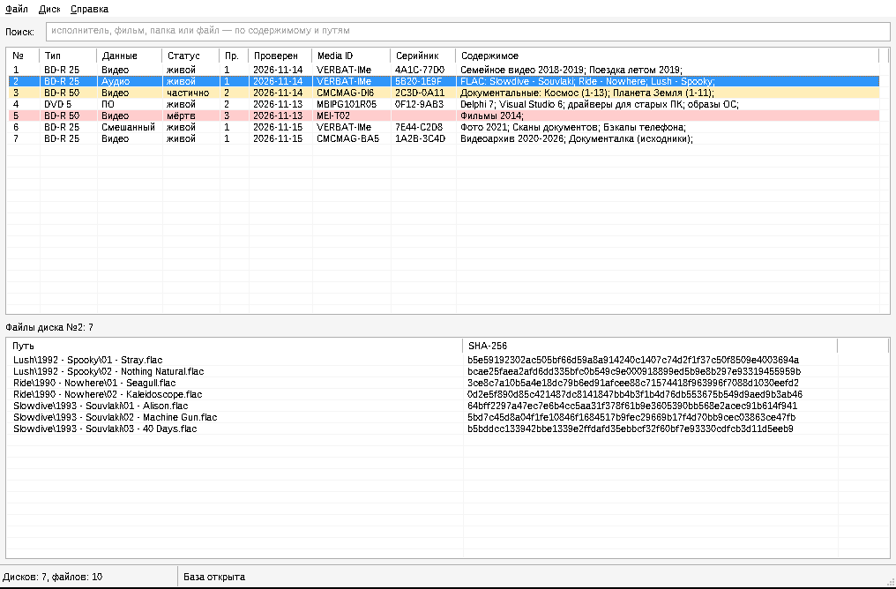

# Backuplist 2

[English](README.md) · **Русский**

Небольшая программа для учёта резервных копий на оптических дисках (Blu-ray, DVD).
Помнит, что лежит на каждом диске, ищет файлы сразу по всем дискам и проверяет
по SHA-256, читается ли ещё старый диск.

Один переносимый 32-битный `.exe` со встроенной SQLite. Работает **от Windows XP SP2
до Windows 11**, не требует установки и сторонних библиотек.



## Возможности

- **Каталог дисков**: номер, тип носителя, дата записи, тип данных, содержимое,
  приоритет, бренд, Media ID. Мёртвые диски подсвечены красным, частично читаемые — жёлтым.
- **Полнотекстовый поиск** по содержимому дисков *и* путям файлов: по началу слова,
  без учёта регистра, кириллица поддерживается.
- **Автоопределение диска.** Вставили диск — программа находит его по серийному номеру
  тома. Неизвестный диск можно добавить или привязать к существующей записи.
- **Добавление диска**: диск читается целиком, SHA-256 каждого файла сохраняется в базу.
  Карточка заполняется сама: следующий номер, сегодняшняя дата, метка, серийник,
  папки верхнего уровня.
- **Проверка** (F6): диск перечитывается и сверяется с сохранёнными хешами.
  Итог — живой / частично читается / мёртв, история проверок в базе и текстовый отчёт
  со списками нечитаемых, повреждённых, пропавших и лишних файлов.
- **Media ID с привода** (например, `VERBAT-IMe-000`, `CMCMAG-DI6-000`, `MBIPG101R05`)
  читается SCSI-командами, как в ImgBurn. Тип носителя (BD-R 25/50/100, DVD 5/9)
  тоже берётся у привода.
- Чтение идёт в фоне: прогресс, скорость, оставшееся время. Отмена срабатывает даже
  на зависшем плохом секторе, и в базу тогда ничего не пишется.
- **Интерфейс на русском и английском**, переключается на лету (Файл → Language / Язык).

## Скачать

Возьмите `backuplist.exe` на странице [Releases](https://github.com/evg00000/backuplist2/releases)
и положите в **папку, куда есть права на запись** (не в `Program Files`).
При первом запуске рядом создастся пустая `backuplist.db`.

## Как пользоваться

1. Вставьте диск. Программа спросит, добавить ли его, — ответьте **Да**,
   проверьте карточку и нажмите **OK**. Диск будет прочитан, хеши сохранятся.
2. Потом вставляйте любой диск из каталога — он найдётся и выделится сам.
3. **F6** — проверка. Итог попадёт в колонку статуса, историю проверок
   и в `reports\disk_NNN_ГГГГ-ММ-ДД.txt`.

Если диски уже были в каталоге без хешей: выделите запись, вставьте диск, нажмите **F6** —
серийник привяжется, а хеши сохранятся как эталон.

| Клавиша | Действие |
|---|---|
| F5 | Определить вставленный диск |
| F6 | Проверить вставленный диск по хешам |
| Ctrl+N | Добавить новый диск |
| Ctrl+I | Сведения о носителе (тип, слои, Media ID) |
| Enter / двойной клик | Карточка диска |
| Del | Удалить запись (сам диск не затрагивается) |
| Ctrl+F | Поиск |
| Ctrl+O | Открыть другую базу |

**Приоритет** вы задаёте сами: 1 — незаменимое (личный архив), 2 — редкое, 3 — заменимое.
Вместе со статусом он подсказывает, какие диски переписывать первыми.

## Про Media ID

- Читается у BD-R/RE и DVD±R/RW. У CD есть только код ATIP, его программа не читает.
- На Windows XP под ограниченной учётной записью Windows не пускает SCSI-команды —
  запустите программу от имени администратора.
- Некоторые USB-переходники SATA не пропускают SCSI-команды: программа так и напишет,
  остальное работает как обычно.

## Файлы рядом с exe

| Файл | Что это |
|---|---|
| `backuplist.db` | база (SQLite) — её тоже стоит бэкапить |
| `backuplist.ini` | выбранный язык интерфейса |
| `reports\` | отчёты о проверках, текст в UTF-8 |

База — обычная SQLite, её можно открыть любым инструментом для SQLite.
Схема — в [`docs/schema.sql`](docs/schema.sql). Полезные представления:

```sql
SELECT * FROM v_media_stats;              -- выживаемость по Media ID: живые / частично / мёртвые
SELECT * FROM v_attention;                -- что требует внимания в первую очередь
SELECT * FROM v_copies WHERE copies = 1;  -- файлы, которые есть только на одном диске
```

## Сборка

Код на чистом C (gnu99) с Win32 API, других зависимостей нет.

**Linux** (Debian/Ubuntu):

```sh
sudo apt install gcc-mingw-w64-i686 make
make          # build/backuplist.exe
make test     # тесты разбора Media ID (обычным gcc)
```

**Windows**: [w64devkit](https://github.com/skeeto/w64devkit) **i686** или MSYS2 **MINGW32**
в `PATH`, затем `build.bat`. Нужен тулчейн с рантаймом **msvcrt**: собранное
с UCRT на XP не запускается.

GitHub Actions собирает каждый push, а тег `v*` публикует релиз с exe.

### Структура

```
src/main.c            главное окно, команды, меню
src/dialogs.c         карточка диска, окно прогресса
src/db.c              все SQL-запросы; схема новой базы
src/scan.c            обход диска и хеширование в отдельном потоке
src/sha256.c          SHA-256 (в CryptoAPI XP SP2 её нет)
src/verify.c          сверка с эталоном, текстовый отчёт
src/volume.c          метка/серийник тома, WM_DEVICECHANGE
src/mediaid.c         SCSI pass-through к приводу
src/mediaid_parse.c   разбор ответов привода (с тестами)
src/lang_strings.h    все строки интерфейса на двух языках
third_party/sqlite/   SQLite 3.49.2 amalgamation (общественное достояние)
```

### Добавить перевод

Все строки интерфейса лежат в `src/lang_strings.h` в виде `X(id, english, russian)`.
Добавьте туда колонку, таблицу и пункт меню в `src/lang.c` / `src/main.c` — и готово.

## Лицензия

[Unlicense](LICENSE) — общественное достояние. SQLite тоже в общественном достоянии.
